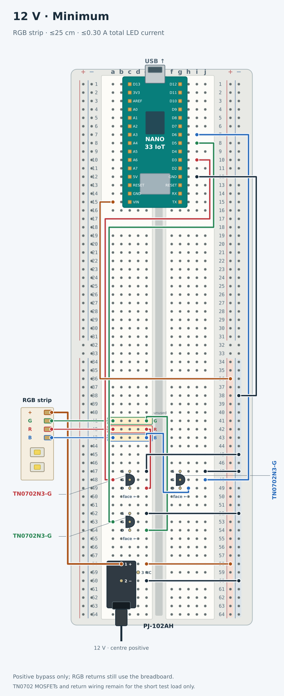

# Kitchen lighting

| 12 V minimum wiring                                                          | PCB layout                                                                                |
| ---------------------------------------------------------------------------- | ----------------------------------------------------------------------------------------- |
| [](12v/min.svg) | [](12v/pcb/pcb-layout.svg) |

## Getting started

- install prerequisites
```sh
sudo apt install kicad kicad-symbols kicad-footprints poppler-utils python3-venv
arduino-cli core install arduino:samd
```

- build artifacts
```sh
python3 12v/build.py
python3 5v/build.py
python3 12v/pcb/pcb.py

mkdir -p 12vRGB
cp 12v/min.ino 12vRGB/12vRGB.ino
arduino-cli compile --fqbn arduino:samd:nano_33_iot --output-dir 12vRGB/build 12vRGB
```

- upload sketch to the nano
```sh
arduino-cli board list
nano_port=/dev/ttyACM0  # Replace with your Nano's port from the list above.
arduino-cli upload --fqbn arduino:samd:nano_33_iot  --port "$nano_port" --input-dir 12vRGB/build 12vRGB
```

## Project files

| Design     | Spec                   | Shopping lists                                    | Best practice       | Minimum            |
| ---------- | ---------------------- | ------------------------------------------------- | ------------------- | ------------------ |
| 12 V RGB   | [spec.md](12v/spec.md) | [min.csv](12v/min.csv) · [best.csv](12v/best.csv) | [SVG](12v/best.svg) | [SVG](12v/min.svg) |
| 5 V APA102 | [spec.md](5v/spec.md)  | [min.csv](5v/min.csv) · [best.csv](5v/best.csv)   | [SVG](5v/best.svg)  | [SVG](5v/min.svg)  |

The generated `min.csv` and `best.csv` shopping lists are compatible with DigiKey’s [Upload a List](https://www.digikey.ca/en/mylists/) feature.

## 12 V PCB

| Drawing                                          | PDF                                 |
| ------------------------------------------------ | ----------------------------------- |
| Schematic                                        | [PDF](12v/pcb/pcb.pdf)              |
| Assembly layout, dimensions and component legend | [PDF](12v/pcb/pcb-layout.pdf)       |
| Plated drill map                                 | [PDF](12v/pcb/pcb-PTH-drl_map.pdf)  |
| Non-plated drill map                             | [PDF](12v/pcb/pcb-NPTH-drl_map.pdf) |

| File                                                 | Purpose                             |
| ---------------------------------------------------- | ----------------------------------- |
| [pcb-notes.md](12v/pcb/pcb-notes.md)                 | Design, ordering, wiring and checks |
| [pcb-cost-estimate.md](12v/pcb/pcb-cost-estimate.md) | Prototype budget in CAD             |
| [pcb.kicad_pro](12v/pcb/pcb.kicad_pro)               | Editable KiCad project              |
| [pcb-gerbers.zip](12v/pcb/pcb-gerbers.zip)           | PCB fabrication upload              |
| [pcb-assembly.zip](12v/pcb/pcb-assembly.zip)         | Complete assembly handoff           |
| [pcb-bom.csv](12v/pcb/pcb-bom.csv)                   | Fitted parts                        |
| [pcb-positions.csv](12v/pcb/pcb-positions.csv)       | Placement data                      |
| [pcb-checks.json](12v/pcb/pcb-checks.json)           | Generated verification results      |

```bash
python3 12v/pcb/pcb.py            # check and export the committed CAD
python3 12v/pcb/pcb.py --rebuild  # reconstruct CAD from the circuit and saved routing
python3 -m unittest discover -s 12v/pcb -p 'test_*.py'
python3 12v/pcb/browser_exports.py  # refresh browser versions of all repository PDFs
```

## Tests

```sh
python3 -m unittest discover -s .utils -p 'test_*.py'
g++ -std=c++11 -Wall -Wextra -Werror -I12v/tests 12v/tests/test_min.cpp -o /tmp/kitchenlighting-test-min
/tmp/kitchenlighting-test-min
```

## Contributing

- markdown tables: `|`s should line up
- diagram preferences:
  - show part numbers; avoid reference codes
  - maximize readability:
    - shorter wires is better
  - avoid using a legend:
    - label components directly
    - draw all connections
  - avoid redundancy (ie. explaining a connection that the diagram clearly displays)
